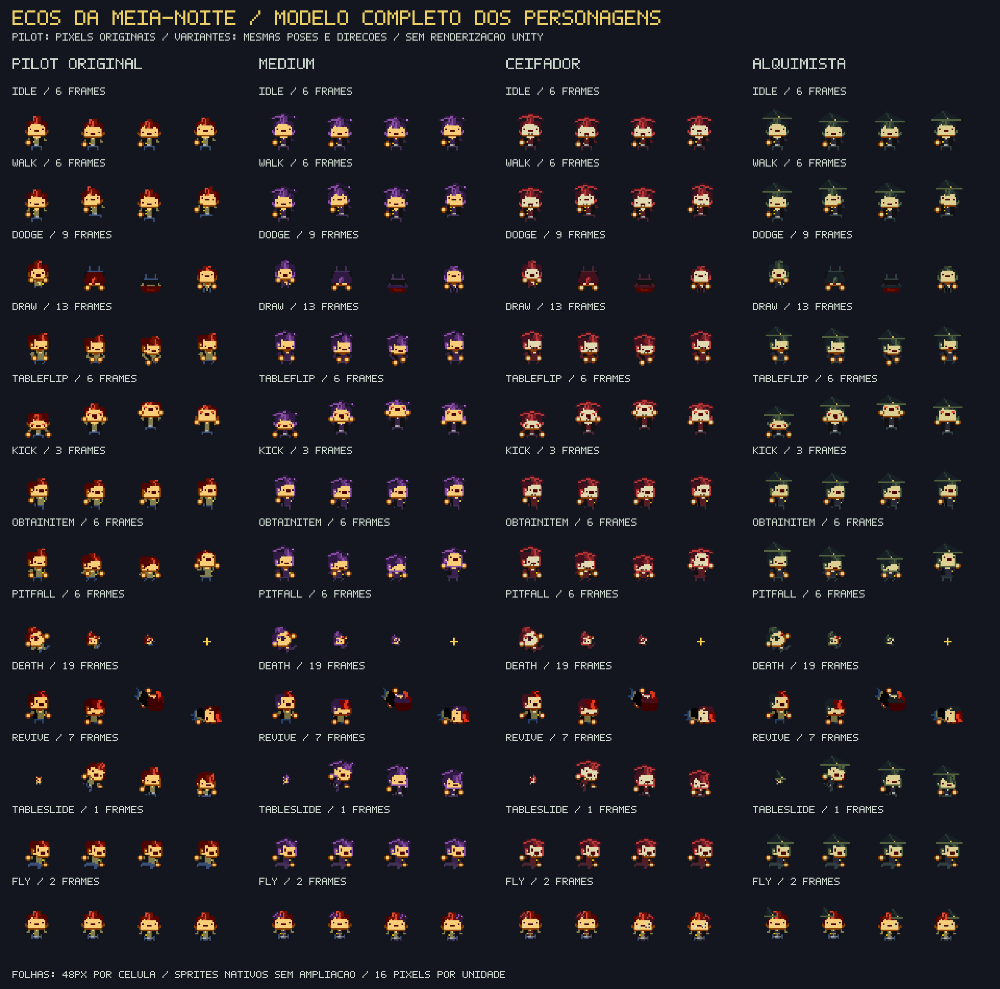

# Personagens no modelo do Pilot original

O usuário forneceu a prancha de *The Pilot*, personagem de *Enter the Gungeon*, extraída por Dr. Flavin conforme o crédito presente na própria imagem. Esse arquivo passa a definir o primeiro personagem e a estrutura de animações das outras três variantes.



## Fonte preservada

O PNG de 1032×853 pixels foi copiado sem alterações para [Assets/_Game/ArtSources/PilotOriginal.png](../Assets/_Game/ArtSources/PilotOriginal.png). Sua identidade é:

```text
SHA256 cd640095da82003f8f44902950382692518393bfa57e61bc9bba1f3abec8f469
```

O arquivo original conserva também títulos, fundos e créditos. O jogo usa folhas derivadas: o importador extrai somente os retângulos catalogados e converte as cores de fundo especificadas em transparência. Os pixels visíveis do Pilot conservam os mesmos valores RGB, sem redimensionamento, redesenho, suavização ou substituição de paleta.

A remoção do fundo é definida por recorte. O tom usado nos painéis de algumas poses também aparece na sombra da prancha; por isso ele não é apagado globalmente. Os retângulos, âncoras e cores permitidas ficam em [Tools/Pilot/source-clips.json](../Tools/Pilot/source-clips.json).

## Quatro personagens, uma estrutura

| Personagem | Folha | Aparência |
| --- | --- | --- |
| Piloto | `pilot.png` | Pixels originais da fonte fornecida |
| Médium | `medium.png` | Variante roxa com acessórios arcanos |
| Ceifador | `reaper.png` | Variante vermelha com capuz e rosto pálido |
| Alquimista | `alchemist.png` | Variante verde/roxa com acessórios de alquimia |

As quatro folhas em [CharacterSheets](../Assets/_Game/Resources/CharacterSheets) compartilham a geometria de animação, os índices, os tempos e as direções. As variantes mudam paletas e acessórios do modelo; o Pilot original é tratado separadamente para impedir que essas transformações alterem seus pixels.

O catálogo atual contém **696 recortes em 135 clips**, compartilhados pelas quatro folhas, incluindo o traje alternativo.

No menu, o primeiro slot aparece como **PILOTO**. Internamente continua usando `CharacterKind.Hunter`, a Carabina da Aurora e o pulso de proteção de nove segundos. Inventário, poderes, munição e controles continuam nos mesmos sistemas.

## Poses e direções

O catálogo organiza poses sem arma, com uma mão e com duas mãos, além do traje alternativo da fonte. As vistas possíveis são frontal, diagonal frontal, lateral, diagonal traseira e traseira. A quantidade de vistas varia por ação e postura; a biblioteca usa uma pose existente quando a prancha não oferece a combinação solicitada.

Cada clip registra seus próprios frames, FPS e repetição. Não existe limite global de quatro quadros para os personagens nativos. Por exemplo, Idle frontal e lateral possuem quantidades diferentes, Walking tem sua própria cadência e a morte pode percorrer uma sequência mais longa. Os braços seguem a postura escolhida; a arma equipada é desenhada separadamente para permitir o arsenal do jogo.

| Família da prancha | Uso nesta revisão |
| --- | --- |
| Idle e Walking, com as três posturas | Pose conforme movimento, mira e arma equipada |
| Dodge roll | Evasão, mantendo a duração e os i-frames do combate |
| Death | Morte com duração e quadros do clip nativo |
| Seleção, apresentação e Draw | Poses de seleção/apresentação disponíveis para o personagem |
| Mesa, chute, baú, item, voo, queda, fantasma, reviver e demais poses | Catalogadas e acessíveis pela biblioteca para futuras interações |

A prancha não fornece uma animação corporal de tiro ou recarga para cada arma do nosso arsenal. As solicitações Attack, Reload e Cast usam a pose Idle correspondente, com recuo, recarga, clarão e poder aplicados pelos sistemas do jogo. A ação de mini blank pertence ao fantasma; usar Q com o personagem vivo não o transforma em fantasma.

As sequências de mesa, baú, voo, fantasma e reviver são dados de animação. Elas não adicionam por si só interação com mesas, abertura de baús, voo ou coop ao jogo.

## Escala e alinhamento

Os personagens nativos usam **16 pixels por unidade**. A célula de organização de 48×48 inclui espaço transparente e conserva a arte pequena em sua escala original. O retângulo efetivamente renderizado e o pivô nos pés ficam em `catalog.json`, em coordenadas Unity. Esse alinhamento permite poses de tamanhos diferentes sem mover o ponto de contato com o chão.

Os mobs, bosses, objetos e equipamentos detalhados continuam usando seus próprios recursos procedurais e escalas. `ReferenceSheets/actors` conserva protótipos dos jogadores para fallback; quando o catálogo nativo está disponível, a apresentação dos jogadores usa `CharacterSheets`.

## Reimportar

Na raiz do projeto:

```bash
python3 -m pip install -r Tools/requirements-sprite-import.txt
python3 Tools/import_pilot_sheet.py
python3 Tools/import_pilot_sheet.py --check
```

O primeiro comando de importação usa por padrão o PNG preservado e `Tools/Pilot/source-clips.json`, gerando folhas, catálogo, metadados e prévia. `--check` compara os resultados sem escrever. O importador verifica o hash da fonte, os retângulos e a cópia dos pixels do Pilot. A fonte permanece intacta.

O carregador C# oferece `CharacterFrame`, `CharacterFrameCount`, `CharacterFrameRate` e `CharacterClipDuration`, com seleção por clip, direção, postura e traje. Texturas importadas são compartilhadas; a biblioteca libera os sprites recortados de sua propriedade.

A prévia é uma montagem dos pixels dos arquivos. Importação no Unity, aparência em movimento e os testes Editor ainda precisam ser conferidos no motor. Consulte [VALIDATION.md](VALIDATION.md).
