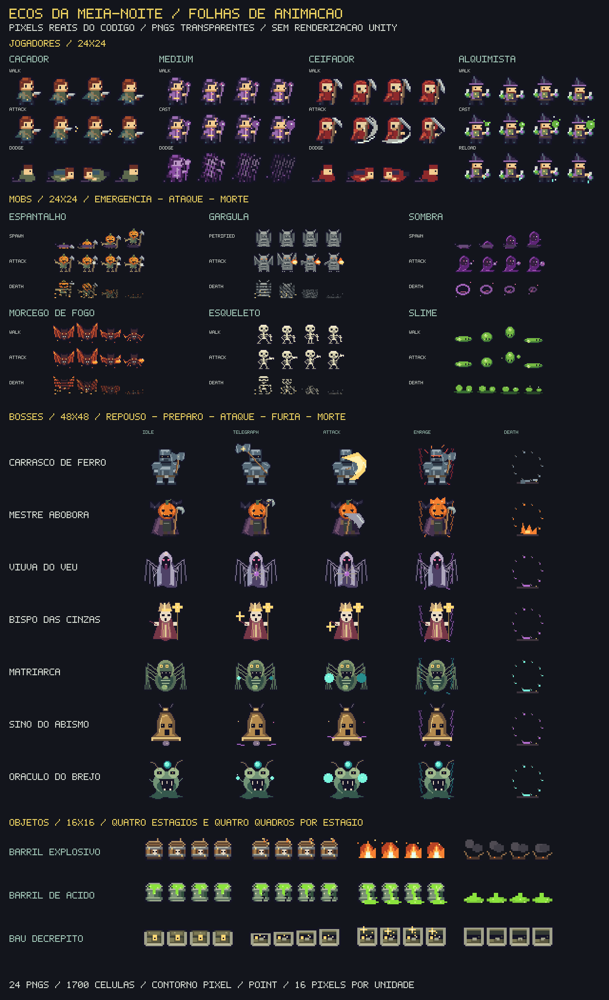

# Folhas de animação da referência

A prancha enviada orienta a aparência atual: heróis compactos com rosto visível, magia roxa, capuz vermelho, chapéu e frascos; Espantalho, Gárgula, Sombra, Morcego de Fogo, Esqueleto e Slime; Carrasco de armadura azul e Mestre Abóbora de capa roxa. Os desenhos foram recriados em pixels pelo C#. Uma prancha reduzida não fornece os arquivos originais de cada pose para reprodução idêntica pixel a pixel.



## Arquivos entregues

Há **24 PNGs RGBA transparentes** em [Assets/_Game/Resources/ReferenceSheets](../Assets/_Game/Resources/ReferenceSheets), com **1.700 células**, filtro Point, sem mipmaps, sem compressão e sem redimensionamento NPOT. A escala é 16 pixels por unidade. As texturas são compartilhadas pelos sprites de cada folha.

| Pasta | Folhas | Célula | Grade | Uso |
| --- | ---: | --- | --- | --- |
| actors | 14 | 24×24 | 4 colunas × 27 linhas | Quatro heróis com equipamento e apenas corpo, mais seis mobs |
| bosses | 7 | 48×48 | 4 × 5 | Repouso, preparação, ataque, fúria e morte |
| props | 3 | 16×16 | 4 × 4 | Barril explosivo, barril de ácido e baú decrépito |

`manifest.json` identifica os frames, estados, direções, pivôs, retângulos e hash de cada PNG. `rect` usa origem superior esquerda, para edição de imagens; `unityRect` usa origem inferior esquerda, para o Unity. A prévia acima é uma montagem dos pixels, sem renderização do motor.

## Atores

As quatro colunas são os frames 0–3. Cada estado ocupa três linhas: lateral direita, costas e frente. A linha é `estado × 3 + direção`, usando a ordem:

1. Idle
2. Walk
3. Attack
4. Dodge
5. Cast
6. Reload
7. Spawn
8. Death
9. Petrified

A lateral esquerda usa espelhamento. O pivô de todas as poses é `(0,5; 2/24)`, nos pés; a posição de apresentação acompanha o chão, o salto ou a flutuação correspondente.

As folhas `player`, `medium`, `reaper` e `alchemist` incluem o equipamento da prancha. As variantes `-body` deixam espaço para a arma equipada do inventário. O jogo usa essas variantes para permitir a troca de armas sem desenhar duas armas sobrepostas. O Ceifador conserva o arco de foice nas poses de ataque.

Movimento, disparo, poder, recarga e evasão escolhem os estados reais do herói. A morte anima por 0,6 s. Os seis mobs escolhem estados por emergência, movimento, preparação e ataque; a Gárgula usa Petrified durante a imunidade. Remanescentes de morte duram 0,42 s, com limite de 32 e descarte ao mudar de sala.

O catálogo restante de mobs e o miniboss preservam suas artes e comportamentos anteriores.

## Bosses e objetos

Cada boss tem uma linha por estado, na ordem `Idle`, `Telegraph`, `Attack`, `Enrage`, `Death`, e quatro quadros. A preparação acompanha o aviso de ataque; a fúria aparece abaixo de 50% de vida. Intro, retratos e morte usam os mesmos desenhos. O pivô é central e o runtime ajusta a altura visual sobre os pés.

Os objetos têm quatro linhas de estágios, cada uma com quatro quadros:

- Explosivo: intacto, ignição, explosão, fumaça/restos.
- Ácido: intacto, rachadura, vazamento, poça.
- Baú: fechado, abrindo, aberto, vazio.

Barris usam esses estágios durante dano, fusível e destruição. A folha do baú fica preparada para uma futura interação; não altera as recompensas das salas.

## Reproduzir e verificar

Na raiz do projeto, com Python 3 e .NET 8 disponíveis:

```bash
python3 Tools/export_sprite_sheets.py
python3 Tools/export_sprite_sheets.py --check
```

O primeiro comando exporta os PNGs, metadados, manifesto e prévia. O segundo compara tudo sem escrever. Os arquivos são determinísticos. Alterações manuais nos PNGs podem ser sobrescritas pela próxima exportação; para mantê-las, ajuste também o gerador ou preserve as imagens antes de exportar.

O executável em `Tools/SpriteSheetExport` compila os métodos reais de arte com interfaces mínimas para capturar pixels. Essas interfaces pertencem somente à ferramenta, fora de `Assets`; não simulam renderização ou execução do Unity. O runtime carrega os PNGs por `Resources` e recorta cada célula. Sem uma folha válida, usa o desenho procedural correspondente como fallback.

Os checks de exportação, pixels, cache e integração passaram fora do motor. Importação, animações renderizadas e os testes Editor ainda precisam de Unity 6000.0.85f1. Consulte [VALIDATION.md](VALIDATION.md).
