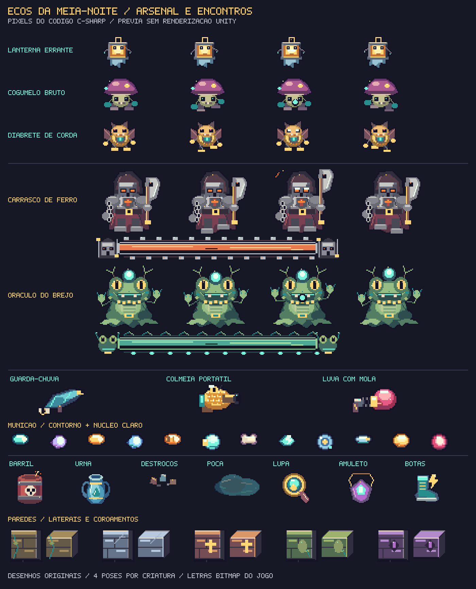

# Ecos da Meia-Noite

Roguelike de ação em pixel art para **Unity 6.0 LTS 6000.0.85f1**, com combate 2D, salas procedurais, quatro personagens, poderes, arsenal, chefes e Mercado das Almas. A arte, os efeitos sonoros e a música são originais e gerados localmente pelo código; o jogo não exige serviços externos.

[**Projeto no GitHub**](https://github.com/ManoelRIos/ecos-vale/tree/codex/ecos-do-vale-vertical-slice) · [**Baixar projeto em ZIP**](https://github.com/ManoelRIos/ecos-vale/raw/refs/heads/codex/ecos-do-vale-vertical-slice/Distribution/EcosDaMeiaNoite.zip)

## Abrir e jogar

1. Instale **Unity 6000.0.85f1** pelo Unity Hub; acrescente Windows Build Support para gerar um executável Windows.
2. Extraia todo o ZIP em uma **pasta nova e curta**, por exemplo `C:\Dev\EcosDaMeiaNoite`. Preserve suas alterações da cópia anterior. A raiz deve conter `Assets`, `Packages` e `ProjectSettings`.
3. No Hub, use **Add / Add project from disk** e selecione essa raiz. Abra o projeto, aguarde os pacotes e a compilação e use **Ecos → Abrir roguelike**, com Play parado, para abrir `Assets/_Game/Scenes/Haunt.unity`.
4. Pressione **Play**, escolha uma das quatro almas e inicie. Uma semente numérica repete a planta, os perfis de encontro, o chefe e as ofertas daquela versão; vazia gera outra incursão.

O atalho opcional `ABRIR_ECOS_DA_MEIA_NOITE.cmd` continua disponível para instalações no caminho padrão do Hub; `/check` confere a pasta e o log fica em `Logs/MeiaNoite-Editor.log`. Abrir pelo Hub dispensa o atalho. O atalho não foi executado no Windows neste ambiente.

Para atualizar por ZIP, use uma extração nova: sobrepor pastas não remove arquivos antigos. Um clone Git atualizado também aplica as remoções rastreadas. Ainda não há um executável Windows validado desta revisão.

## Combate com mais variedade

Cada sala de combate mantém **três ondas**, mas recebe um perfil próprio: **enxame**, **emboscada**, **fogo cruzado** ou **elite**. Formações e combinações variam, os inimigos são mais ativos e a vida cresce de modo mais moderado. As criaturas emergem de fendas durante 0,9 s; nesse preparo não atacam nem recebem dano. A recompensa e as saídas são liberadas após a última onda. Minibosses aparecem junto aos grupos em salas determinadas pela semente.

Há treze criaturas comuns, além do miniboss e dos chefes. As novas são **Lanterna Errante**, que orbita e atira; **Cogumelo Bruto**, que pressiona com avanços e ataques marcados; e **Diabrete de Corda**, que alterna movimento e rajadas. A separação entre criaturas reduz os amontoados. O runtime limita os tiros hostis a 140 e reserva capacidade para os disparos do jogador.

As salas têm **barris explosivos** e **urnas de água** atingíveis por tiros de ambos os lados e por raios. Barris anunciam a explosão por 0,55 s, ferem criaturas e jogador e podem provocar reações em cadeia; cobertura bloqueia a explosão. Urnas deixam poças por até 14 s, reduzindo a velocidade de quem anda sobre elas a 60%; esquivar permite atravessar sem essa redução. Objetos quebrados permanecem quebrados ao revisitar a sala durante a incursão.

Andares começam com 7 salas, recebem duas a cada avanço e chegam ao limite de 27. Arenas medem 29 × 17 unidades, com câmera próxima que acompanha o personagem. Algumas salas têm abismos atravessáveis por esquiva/salto; cair custa uma vida e retorna ao último chão seguro. Uma seta aponta à saída mais próxima após a purificação e prioriza o portal após o chefe.

## Pixel art, projéteis e profundidade

Os tiros agora têm **corpo maior, contorno contrastante e núcleo claro**, com cápsulas, pétalas, ossos, discos e energia de formas distintas. Um halo curto acompanha o corpo na mesma altura, acompanhado de clarão e rastro colorido. Os disparos hostis preservam borda rosa/vermelha. A relíquia de tamanho também aumenta o raio de colisão, mantendo a melhoria funcional.

A apresentação reforça o aspecto **2.5D por camadas**: paredes têm faces elevadas e coroamentos, os objetos projetam sombras, atores e cobertura são ordenados pela posição dos pés e as paredes próximas ficam translúcidas quando cobririam o personagem. A posição elevada dos sprites não altera a colisão no chão. A câmera e a simulação continuam no plano 2D; esta revisão não converte o cenário para malhas 3D. Há neblina baixa animada em temas e salas específicos, sem passar sobre os projéteis.

Os cinco temas mantêm pisos e paredes próprios: Jardins da Colheita, Galeria dos Véus, Catedral das Cinzas, Ninho da Peste e Abismo dos Sinos. Os relevos, velas, candelabros, manchas e a disposição da cobertura aumentam a densidade visual. A interface usa letras bitmap 5 × 7; o HUD mantém corações e textos sem tarjas.

A prévia abaixo mostra os pixels gerados pelos métodos C# com tipos auxiliares fora do Editor. **Não é captura da renderização Unity.**



## Personagens, arsenal e relíquias

| Alma | Arma inicial | Poder |
| --- | --- | --- |
| Caçador da Aurora | Carabina da Aurora, cápsula turquesa | Limpa tiros próximos e concede proteção breve |
| Médium do Véu | Varinha do Véu, pétalas em leque | Rajada espectral ampla |
| Ceifador Errante | Ceifador de Ossos, dano duplo | Disparo radial e proteção breve |
| Alquimista de Cinzas | Bobina Voltaica, raio contínuo | Recupera vida |

A loja sorteia **uma ou duas armas por andar**, entre as ainda não adquiridas. A seleção fica estável durante a visita, inclusive depois de comprar; cada produto aparece em uma vitrine. O catálogo também vende cura, dano, cadência, vida máxima e três relíquias:

- **Balas Gigantes:** +30 pontos percentuais de tamanho por compra, até 160%, com aumento correspondente da colisão.
- **Botas Ligeiras:** +12,5 pontos percentuais de velocidade por compra, até 125%.
- **Relíquia da alma:** Olho da Aurora ou Dente Lunar concedem +1 de dano aos tiros; Fita do Véu reduz a recarga do poder em 30%; Coração Voltaico aumenta a cura para 3 e reduz sua recarga em 15%.

As três novas armas são o **Guarda-Chuva**, com cinco pétalas e dois ricochetes; a **Colmeia de Bolso**, com três ferrões de perseguição suave; e a **Luva de Boxe**, com tiro pesado que empurra criaturas sem atravessar obstáculos. O catálogo inclui ainda Grampeador, Banana, Pião do Caos, Disco Espelho, Lanterna de Raios, Flauta de Ossos, Bacamarte, Repetidora e Canhão das Almas. Armas têm cadências e padrões próprios; cobertura e paredes bloqueiam projéteis e raios.

Caminhe até o atendente e use E/X ou clique nele para abrir o catálogo a até 2,8 unidades. Apenas a conversa bloqueia o movimento. Itens usam ícones, preço e uma característica curta, com três cartões por página. Feche a conversa e caminhe até o portal para descer. Compras recusadas não consomem almas; equipamentos e melhorias duram até o fim da incursão.

## Sete chefes

Todos têm animação, ataques anunciados e barra de vida em pixel art na parte inferior. **Carrasco de Ferro** e **Oráculo do Brejo** juntam-se aos cinco guardiões anteriores, com três padrões próprios e mudança de intensidade quando feridos. O tema sorteia um destes três candidatos a cada andar:

| Tema | Candidatos |
| --- | --- |
| Jardins da Colheita | Rei das Abóboras, Viúva do Véu, Carrasco de Ferro |
| Galeria dos Véus | Viúva do Véu, Bispo das Cinzas, Oráculo do Brejo |
| Catedral das Cinzas | Bispo das Cinzas, Sino do Abismo, Carrasco de Ferro |
| Ninho da Peste | Matriarca da Peste, Oráculo do Brejo, Rei das Abóboras |
| Abismo dos Sinos | Sino do Abismo, Carrasco de Ferro, Oráculo do Brejo |

## Teclado, mouse e controle

O suporte inicial usa o **Unity Input System**. Um **DualShock 4 de PS4** reconhecido pelo sistema pode ser usado por USB ou Bluetooth; o funcionamento no hardware/driver específico ainda precisa ser testado. Mira mantém a última direção do analógico direito. Menus, seleção de personagem, loja, pausa e reinício podem ser operados sem mouse.

| Ação | Teclado / mouse | Controle PS4 |
| --- | --- | --- |
| Mover | WASD / setas | Analógico esquerdo |
| Mirar | Mouse | Analógico direito |
| Atirar | Botão esquerdo | R2 |
| Esquivar / saltar | Espaço / botão direito | Círculo / L2 |
| Usar poder | Q | Quadrado |
| Conversar / usar portal | E | X |
| Trocar arma | Tab / roda do mouse; 1–0 para atalhos | L1 / R1 |
| Mapa | M | Share / clique no touchpad |
| Pausar | Esc | Options |
| Navegar e confirmar menu | Mouse | Direcional / analógico esquerdo e X |
| Fechar conversa | Esc / Fechar | Círculo |
| Abas / páginas da loja | Botões do catálogo | L1/R1 e Triângulo |

Atalhos: 1 arma inicial; 2 Grampeador; 3 Banana; 4 Pião; 5 Disco; 6 Lanterna; 7 Flauta; 8 Guarda-Chuva; 9 Colmeia; 0 Luva. Tab, roda e L1/R1 alcançam todo o inventário. O mesmo X que abre uma tela não compra um item.

M abre um atlas de 1060 × 580 na referência 1280 × 720, com desenhos a 95% e fundo escuro a 78%. O minimapa mantém 45% de opacidade. Ambos são passivos: o combate continua.

## Música e efeitos

Cinco trilhas sintetizadas originais usam melodia, harmonia, baixo e percussão. O mercado recebe uma camada calma; o combate e os chefes aumentam a intensidade, com transições suaves. Disparos, impactos, poderes, explosões, água, compras e mortes têm efeitos curtos. O áudio tem limite de vozes, pausa com o jogo, respeita perda de foco e pode ser desligado em **SOM** no menu de pausa. Não são necessários arquivos de áudio externos.

## Desenvolvimento e limites da validação

```bash
python3 -m pip install -r Tools/requirements-validation.txt
python3 Tools/validate_project.py
python3 -m unittest discover -s Tools -p 'test_*.py'
dotnet run --project Tools/HauntChecks.csproj
```

Passaram **24 testes Python** e **492.814 asserções do núcleo real C#**, incluindo 2.436 andares. A sintaxe e os metadados também foram conferidos. Helpers temporários com tipos Unity simulados verificaram contratos entre os parciais e lógica de combate, objetos, controle, arte e áudio; não são uma execução no motor.

**O Editor Unity não está instalado neste ambiente.** Importação, compilação no Unity, aparência renderizada, reprodução sonora, build e controle PS4 físico ainda precisam ser validados no Editor/PC. O jogo continua solo e sem save entre sessões. Consulte [VALIDATION.md](Documentation/VALIDATION.md), [ARCHITECTURE.md](Documentation/ARCHITECTURE.md) e [UNITY_TROUBLESHOOTING.md](Documentation/UNITY_TROUBLESHOOTING.md).

Com Editor licenciado, execute o Test Runner ou `bash Tools/unity-check.sh import`, `smoke`, `tests` e `build`, com `UNITY_EDITOR_PATH` definido. O build usa `Builds/Windows/EcosDaMeiaNoite.exe`. Para gerar o ZIP das fontes, inclua arquivos novos no índice Git e execute `python3 Tools/package_project.py`; o pacote tem raiz `EcosDaMeiaNoite/` e não inclui builds ou caches.
