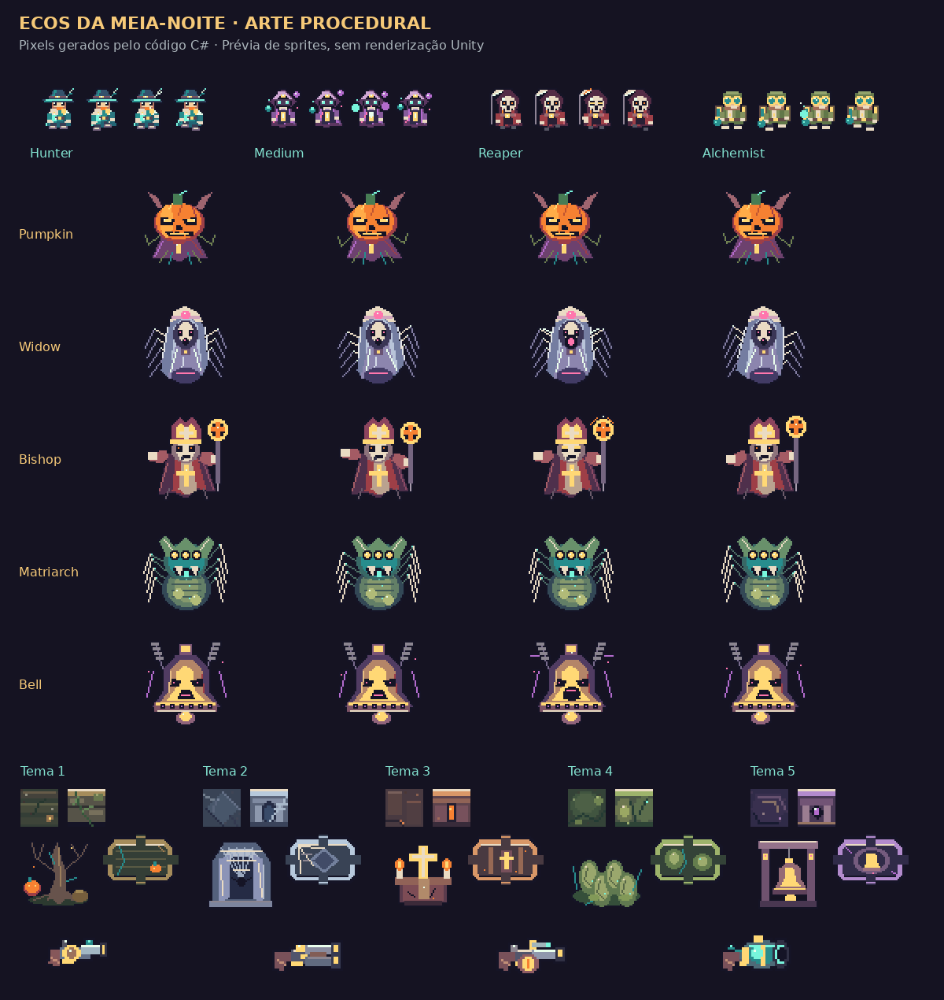
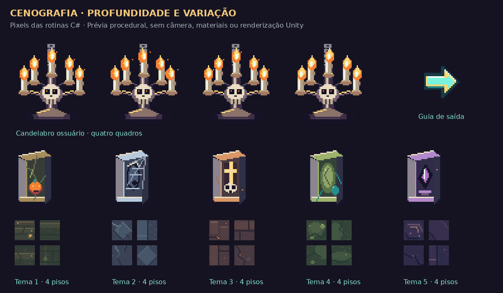

# Ecos da Meia-Noite

Roguelike 2D em pixel art para **Unity 6.0 LTS 6000.0.85f1**. Explore uma cripta de Halloween, enfrente criaturas e projéteis, derrote o guardião do andar e visite o Mercado das Almas antes de continuar.

O projeto contém somente este jogo: cena `Haunt.unity`, combate, geração de salas, loja, interface e ferramentas de desenvolvimento. Os sprites são originais, gerados por código e exibidos com filtro de ponto. A prévia abaixo foi regenerada a partir das rotinas de desenho C# desta revisão; ela não é uma captura do Unity.

[**Projeto no GitHub**](https://github.com/ManoelRIos/ecos-vale/tree/codex/ecos-do-vale-vertical-slice)

[**Baixar o projeto em ZIP**](https://github.com/ManoelRIos/ecos-vale/raw/refs/heads/codex/ecos-do-vale-vertical-slice/Distribution/EcosDaMeiaNoite.zip)

## Abrir e jogar

1. Instale **Unity 6000.0.85f1** pelo Unity Hub. Inclua **Windows Build Support** se quiser gerar um executável Windows.
2. Extraia todo o ZIP em uma **pasta nova e curta**, por exemplo `C:\Dev\EcosDaMeiaNoite`. A pasta deve conter `Assets`, `Packages`, `ProjectSettings` e `ABRIR_ECOS_DA_MEIA_NOITE.cmd`.
3. Feche o Editor aberto em outra cópia e execute **ABRIR_ECOS_DA_MEIA_NOITE.cmd**. O atalho confere os arquivos e solicita a abertura de `Haunt.unity` após a importação. Se a instalação do Editor estiver fora do caminho padrão do Hub, adicione essa pasta pelo Hub e use **Ecos → Abrir roguelike**, com o Play parado.
4. Aguarde a resolução dos pacotes e a compilação, pressione **Play** e inicie uma incursão pelo menu. Uma semente numérica repete a disposição das salas e a escolha do guardião de cada andar; campo vazio gera outra semente.

Use uma extração nova para atualizar uma cópia recebida por ZIP: sobrepor arquivos não remove arquivos que deixaram de fazer parte do projeto. Preserve alterações próprias antes de trocar de pasta. Em um clone Git, a atualização da branch também aplica as remoções dos arquivos rastreados.

O log do atalho fica em `Logs/MeiaNoite-Editor.log`. `ABRIR_ECOS_DA_MEIA_NOITE.cmd /check` verifica a pasta sem abrir o Editor. O atalho recebeu verificação estática, sem execução Windows neste ambiente.

## Leitura visual e animação

O caçador usa capa turquesa e marfim, chapéu largo e um marcador verde-água nos pés. Inimigos têm silhuetas próprias: abóbora laranja, fantasma claro, cultista violeta e morcego de asas largas. Sprites maiores e animações de quatro quadros por criatura ajudam a reconhecer movimento e ataques.

Portas abertas mostram passagem e seta luminosa; portas seladas exibem grades e cadeado; a passagem do guardião tem moldura dourada. Cada um dos cinco temas usa paredes e pisos próprios, relevos, velas e candelabros macabros animados. Quatro variantes de piso por tema recebem tom, espelhamento e rotação determinados pela semente e posição do ladrilho. O mercado tem tapete e mercador próprios.

Há rastro de esquiva, poeira de passos, recuo e clarão da arma, halo luminoso e rastro nos tiros, avisos de ataque, partículas de impacto/morte e pulsos de vitória. Os efeitos têm limites e reaproveitam objetos. A apresentação eleva os sprites mantendo as posições físicas do combate. A câmera próxima acompanha o personagem dentro dos limites da arena e reposiciona imediatamente nas chegadas. Após purificar uma sala, uma seta aponta para a porta mais próxima; depois do chefe, ela prioriza o portal do mercado.

O shader segue o contrato de cor e espelhamento do SpriteRenderer do URP 17/Unity 6. A prévia abaixo mostra os desenhos gerados; a renderização desta revisão no Editor ainda precisa ser validada.





## Personagens e arsenal

Escolha uma das quatro almas no menu antes de iniciar:

- **Caçador da Aurora**: `Q` dissipa projéteis hostis num raio de 5 unidades e concede 0,65 s de proteção. Recarga: 9 s.
- **Médium do Véu**: `Q` dispara nove projéteis em leque com três vezes o dano base. Recarga: 7 s.
- **Ceifador Errante**: `Q` lança doze tiros radiais com dano duplo e concede 0,4 s de proteção. Recarga: 8 s.
- **Alquimista de Cinzas**: `Q` recupera até 2 pontos de vida. Recarga: 18 s; vida cheia não consome o poder.

O mercado vende **bacamarte** (55 almas + escala do andar, cinco projéteis, intervalo ×2,8), **repetidora** (65 + escala, intervalo ×0,55) e **canhão das almas** (80 + escala, dano ×5 e intervalo ×3,5). As armas são permanentes durante a incursão, equipadas na compra e selecionadas por `1–4` ou pelo botão de uma arma já adquirida. Uma nova incursão começa apenas com o revólver.

Os cinco temas são Jardins da Colheita, Galeria dos Véus, Catedral das Cinzas, Ninho da Peste e Abismo dos Sinos. Cada um tem pisos, paredes, cobertura e decoração próprios: raízes e madeira, mármore e teias, altares e cinzas, ovos e quitina, obsidiana e sinos; a corrupção visual aumenta com a profundidade sem apagar os projéteis. O mapa usa miniaturas ilustradas com a mesma identidade do andar, corredores e retratos dos guardiões. Cantos verdes identificam a sala atual. Há partículas ambientes, halos nos disparos, clarões e estilhaços nos impactos e até 320 efeitos reutilizáveis. Halos, chamas e efeitos luminosos usam sprites com mistura aditiva; não há iluminação física dinâmica URP.

## Combate e progressão

- Arenas de **29 × 17 unidades**, cerca de 2,1 vezes a área anterior, com portas, cobertura e chegadas ajustadas. A câmera ortográfica de tamanho 6,3 acompanha o personagem com limites; explore o espaço usando a seta e o mapa. A ampliação cria mais espaço para manobra; o jogo ainda é solo.
- Andares com 7–11 salas conectadas por portas, determinadas pela semente. A entrada é segura; as saídas de uma sala de combate ficam seladas até todos os inimigos morrerem.
- Movimento em oito direções, mira pelo mouse, disparos e esquiva com invulnerabilidade temporária.
- Sete criaturas: abóbora perseguidora, fantasma atirador, cultista com rajadas, morcego de bote, larva da peste em zigue-zague, sentinela óssea com disparos em cruz e acólito do sino com tiros duplos. A composição favorece criaturas ligadas ao guardião do andar.
- Um chefe por andar, sorteado pela semente entre três candidatos do tema atual. O catálogo contém Rei das Abóboras, Viúva do Véu, Bispo das Cinzas, Matriarca da Peste e Sino do Abismo. Viúva, Bispo, Matriarca e Sino têm sprites próprios de 56 × 56 pixels, poses de conjuração e dois padrões alternados: a Viúva carrega e lança teias, o Bispo consagra o chão, a Matriarca combina espirais com erupções e o Sino alterna pulsos e faixas. Os ataques de chão são marcados por 1,1 s antes de causar dano; a purificação cancela marcas pendentes. O ciclo de cinco temas se repete, mantendo o aumento de dificuldade. A seleção do chefe usa uma sequência aleatória separada e não altera a disposição das salas.
- Após vencer o chefe, um portal leva ao Mercado das Almas. A tela da loja substitui o HUD de combate, com abas **Melhorias** e **Armas**, até quatro cartões por vez e botão **Descer ao próximo andar**. Não há compras invisíveis por proximidade nem movimento por trás do painel. Compre até 3 pontos de cura, +1 de dano, intervalo entre tiros 15% menor ou +2 de vida máxima. Cada item pode ser comprado uma vez por visita; uma compra recusada não consome moedas.
- O próximo andar preserva vida, moedas, armas, personagem e melhorias. Morrer encerra a incursão e permite repetir a semente ou gerar outra.
- HUD sem tarjas e molduras: corações no canto superior esquerdo, textos compactos de almas, arma e recarga; nome e vida do chefe em texto. As informações da sala aparecem brevemente ao entrar.
- Mapa temático sem fundo, desenhado atrás do HUD: 16% de opacidade na visão pequena e 30% no atlas ampliado com M. A sobreposição é passiva e permite mirar/atirar através dela. Notificações e rótulos também usam texto sem caixas; menus e loja mantêm seus controles.

| Controle | Ação |
| --- | --- |
| WASD | Mover |
| Mouse | Mirar |
| Botão esquerdo | Atirar |
| Espaço / botão direito | Esquivar |
| Caminhar até uma saída aberta | Trocar de sala |
| E | Usar portal após vencer o chefe |
| Botões da loja | Comprar/equipar nas abas e descer ao próximo andar |
| Q | Usar poder do personagem |
| 1 / 2 / 3 / 4 | Revólver / bacamarte / repetidora / canhão, quando adquiridos |
| M | Alternar mapa |
| Esc | Pausar / retomar |

## Guardiões possíveis por tema

| Tema | Três candidatos |
| --- | --- |
| Jardins da Colheita | Rei das Abóboras, Viúva do Véu, Matriarca da Peste |
| Galeria dos Véus | Viúva do Véu, Bispo das Cinzas, Sino do Abismo |
| Catedral das Cinzas | Bispo das Cinzas, Sino do Abismo, Rei das Abóboras |
| Ninho da Peste | Matriarca da Peste, Viúva do Véu, Rei das Abóboras |
| Abismo dos Sinos | Sino do Abismo, Matriarca da Peste, Bispo das Cinzas |

O tema define paredes, decoração e criaturas comuns; o guardião sorteado mantém sua própria arte e seus ataques.

## Desenvolvimento e validação

O jogo é local e não exige serviços externos, contas de API ou segredos. A configuração de renderização prepara somente o URP e os recursos usados pelo roguelike.

```bash
python3 -m pip install -r Tools/requirements-validation.txt
python3 Tools/validate_project.py
python3 -m unittest discover -s Tools -p 'test_*.py'
dotnet run --project Tools/HauntChecks.csproj
```

`HauntChecks` compila o núcleo real em C# puro, sem stubs Unity, e verifica mapas, progressão, compras e colisões de projéteis. Os checks Python verificam a estrutura, os metadados, as versões e o empacotamento. Eles não substituem a compilação ou a execução no Editor.

Com um Editor licenciado, execute os testes em `Assets/_Game/Haunt/Tests/Editor` pelo Test Runner, ou use:

```bash
export UNITY_EDITOR_PATH='/caminho/para/Unity'
bash Tools/unity-check.sh import
bash Tools/unity-check.sh smoke
bash Tools/unity-check.sh tests
bash Tools/unity-check.sh build
```

O build Windows usa `Builds/Windows/EcosDaMeiaNoite.exe`. Para empacotar as fontes, inclua os arquivos novos no índice Git e execute `python3 Tools/package_project.py`; o resultado é `Distribution/EcosDaMeiaNoite.zip`, com raiz `EcosDaMeiaNoite/`.

**Estado da verificação:** passaram 24 testes Python, análise de sintaxe de 12 arquivos C# e 118.188 asserções do núcleo. O Editor Unity não está instalado neste ambiente. A importação desta versão, a compilação completa Unity, o Play Mode, os shaders e o build ainda precisam ser executados no Editor. Os testes Unity verificam objetos e estado, sem certificar a aparência renderizada. Consulte [VALIDATION.md](Documentation/VALIDATION.md) para o roteiro de verificação e [UNITY_TROUBLESHOOTING.md](Documentation/UNITY_TROUBLESHOOTING.md) se a abertura falhar.

Esta é uma base de combate e progressão. Áudio, animação, arte e balanceamento ainda precisam de refinamento. Esta expansão possui validação do núcleo e de sintaxe; a nova aparência e os testes de integração aguardam execução no Editor. As incursões não têm persistência entre sessões nem multiplayer.

## Organização

- `Assets/_Game/Haunt/Core`: geração de andares, estado da incursão e geometria em C# puro.
- `Assets/_Game/Haunt/Runtime`: combate, renderização e interface.
- `Assets/_Game/Haunt/Art`: sprites procedurais e shader.
- `Assets/_Game/Haunt/Editor`: configuração URP, abertura da cena e build.
- `Assets/_Game/Haunt/Tests/Editor`: testes de integração no Unity.
- `Assets/_Game/Scenes/Haunt.unity`: única cena do jogo e entrada do build.
- `Assets/_Game/Resources`: material de sprites e recursos URP usados pelo jogo.

Veja [ARCHITECTURE.md](Documentation/ARCHITECTURE.md) e [PACKAGES.md](Documentation/PACKAGES.md).
