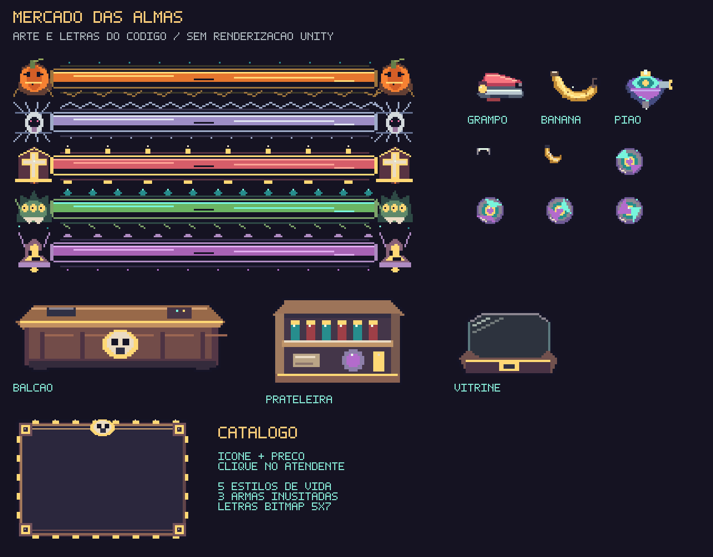
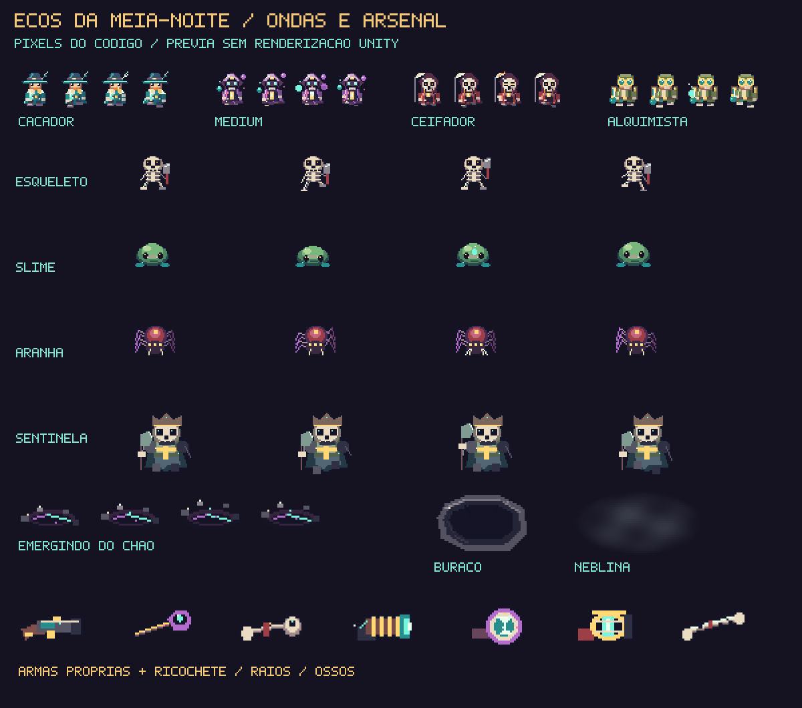

# Ecos da Meia-Noite

Roguelike 2D em pixel art para **Unity 6.0 LTS 6000.0.85f1**. Explore uma cripta de Halloween, enfrente criaturas e projéteis, derrote o guardião do andar e visite o Mercado das Almas antes de continuar.

O projeto contém somente este jogo: cena `Haunt.unity`, combate, geração de salas, loja, interface e ferramentas de desenvolvimento. Os sprites são originais, gerados por código e exibidos com filtro de ponto. As prévias abaixo usam as rotinas de desenho C# com tipos auxiliares mínimos fora do Editor; não são capturas do Unity.

[**Projeto no GitHub**](https://github.com/ManoelRIos/ecos-vale/tree/codex/ecos-do-vale-vertical-slice)

[**Baixar o projeto em ZIP**](https://github.com/ManoelRIos/ecos-vale/raw/refs/heads/codex/ecos-do-vale-vertical-slice/Distribution/EcosDaMeiaNoite.zip)

## Abrir e jogar

1. Instale **Unity 6000.0.85f1** pelo Unity Hub. Inclua **Windows Build Support** se quiser gerar um executável Windows.
2. Extraia todo o ZIP em uma **pasta nova e curta**, por exemplo `C:\Dev\EcosDaMeiaNoite`. A pasta deve conter `Assets`, `Packages`, `ProjectSettings` e `ABRIR_ECOS_DA_MEIA_NOITE.cmd`.
3. Feche o Editor aberto em outra cópia e execute **ABRIR_ECOS_DA_MEIA_NOITE.cmd**. O atalho confere os arquivos e solicita a abertura de `Haunt.unity` após a importação. Se a instalação do Editor estiver fora do caminho padrão do Hub, adicione essa pasta pelo Hub e use **Ecos → Abrir roguelike**, com o Play parado.
4. Aguarde a resolução dos pacotes e a compilação, pressione **Play** e inicie uma incursão pelo menu. Uma semente numérica repete a disposição das salas e a escolha do guardião de cada andar; campo vazio gera outra semente.

Use uma extração nova para atualizar uma cópia recebida por ZIP: sobrepor arquivos não remove arquivos que deixaram de fazer parte do projeto. Preserve alterações próprias antes de trocar de pasta. Em um clone Git, a atualização da branch também aplica as remoções dos arquivos rastreados.

O log do atalho fica em `Logs/MeiaNoite-Editor.log`. `ABRIR_ECOS_DA_MEIA_NOITE.cmd /check` verifica a pasta sem abrir o Editor. O atalho recebeu verificação estática, sem execução Windows neste ambiente.

## Leitura visual e animação

As quatro almas têm roupas, armas e silhuetas próprias, com contornos, sombras e detalhes de luz. O caçador usa capa turquesa e marfim, chapéu largo e um marcador verde-água nos pés. Inimigos têm silhuetas próprias, incluindo abóbora, fantasma, cultista, morcego, esqueleto, slime e aranha. Animações de quatro quadros por criatura ajudam a reconhecer movimento e ataques.

Portas abertas mostram passagem e seta luminosa; portas seladas exibem grades e cadeado; a passagem do guardião tem moldura dourada. Cada um dos cinco temas usa paredes e pisos próprios, relevos, velas e candelabros macabros animados. Quatro variantes de piso por tema recebem tom, espelhamento e rotação determinados pela semente e posição do ladrilho. O mercado é uma sala explorável com balcão, atendente, prateleiras e seis armas expostas em vitrines.

Há rastro de esquiva, poeira de passos, recuo e clarão da arma, projéteis compactos e rastros curtos, avisos de ataque, partículas de impacto/morte e pulsos de vitória. Os efeitos têm limites e reaproveitam objetos. A apresentação eleva os sprites mantendo as posições físicas do combate. A câmera próxima acompanha o personagem dentro dos limites da arena e reposiciona imediatamente nas chegadas. Após purificar uma sala, uma seta aponta para a porta mais próxima; depois do chefe, ela prioriza o portal do mercado.

O shader segue o contrato de cor e espelhamento do SpriteRenderer do URP 17/Unity 6. A prévia abaixo mostra os desenhos gerados; a renderização desta revisão no Editor ainda precisa ser validada.






## Personagens e arsenal

Escolha uma das quatro almas no menu antes de iniciar:

- **Caçador da Aurora**: começa com a **Carabina da Aurora**, de tiro rápido e preciso. `Q` dissipa projéteis hostis num raio de 5 unidades e concede 0,65 s de proteção. Recarga: 9 s.
- **Médium do Véu**: começa com a **Varinha do Véu**, que lança três tiros em leque. `Q` dispara nove projéteis em leque com três vezes o dano base. Recarga: 7 s.
- **Ceifador Errante**: começa com o **Ceifador de Ossos**, com dano duplo por tiro. `Q` lança doze tiros radiais com dano duplo e concede 0,4 s de proteção. Recarga: 8 s.
- **Alquimista de Cinzas**: começa com a **Bobina Voltaica**, um raio contínuo de alcance curto. `Q` recupera até 2 pontos de vida. Recarga: 18 s; vida cheia não consome o poder.

O mercado vende seis armas inusitadas, distribuídas em duas páginas com três armas cada:

| Arma | Disparo | Preço inicial | Intervalo sobre a cadência base |
| --- | --- | --- | --- |
| Grampeador | Dois grampos por disparo, cada um com o dano base | 55 almas | ×1,4 |
| Banana | Projétil curvo com dano ×3 | 65 almas | ×2,2 |
| Pião do Caos | Pião giratório com dano ×2, atravessa até três inimigos distintos | 80 almas | ×3,5 |
| Disco Espelho | Dano ×2 e até dois ricochetes em paredes ou cobertura | 70 almas | ×1,7 |
| Lanterna de Raios | Raio contínuo de alcance 11, dano ×2 por pulso | 90 almas | ×0,6 |
| Flauta de Ossos | Três ossos em leque, cada um com dano ×2 | 75 almas | ×2 |

Os preços recebem a escala normal do andar. Os grampos viajam a 19 unidades/s; a banana curva a 52°/s; o pião viaja a 8 unidades/s e dura até 2,8 s. Paredes e cobertura bloqueiam os tiros e raios; o Disco Espelho reflete até duas vezes. A Bobina Voltaica alcança 7 unidades e causa dano base por pulso. Segurar o disparo mantém os raios acompanhando a mira, com dano na cadência da arma. Os novos projéteis usam desenhos abstratos de 6–8 pixels e escala reduzida, em vez de grandes objetos detalhados.

As armas duram até o fim da incursão e são equipadas na compra. Use `1` para voltar à arma inicial do personagem, `2` para grampeador, `3` para banana, `4` para pião, `5` para disco, `6` para lanterna e `7` para flauta. Uma nova incursão restaura a arma específica da alma escolhida.

Os cinco temas são Jardins da Colheita, Galeria dos Véus, Catedral das Cinzas, Ninho da Peste e Abismo dos Sinos. Cada um tem pisos, paredes, cobertura e decoração próprios: raízes e madeira, mármore e teias, altares e cinzas, ovos e quitina, obsidiana e sinos; a corrupção visual aumenta com a profundidade sem apagar os projéteis. O mapa usa miniaturas ilustradas com a mesma identidade do andar, corredores e retratos dos guardiões. Cantos verdes identificam a sala atual. Há partículas ambientes, brilho discreto apenas nos projéteis de energia e poeira nos impactos e até 320 efeitos reutilizáveis. Halos, chamas e efeitos luminosos usam sprites com mistura aditiva; não há iluminação física dinâmica URP.

## Combate e progressão

- Arenas de **29 × 17 unidades**, cerca de 2,1 vezes a área anterior, com portas, cobertura e chegadas ajustadas. A câmera ortográfica de tamanho 6,3 acompanha o personagem com limites; explore o espaço usando a seta e o mapa. A ampliação cria mais espaço para manobra; o jogo ainda é solo.
- Andares com **7–27 salas** conectadas por portas, determinadas pela semente: começam com 7 e recebem 2 por andar, até o limite de 27. A entrada é segura. Cada sala de combate tem **três ondas**; saídas e recompensa são liberadas somente após a terceira. Os inimigos emergem de fendas no chão durante 0,9 s, sem atacar nem receber dano nesse preparo.
- Uma sala de combate por andar recebe um miniboss junto aos inimigos da terceira onda; a partir do quarto andar, são duas salas com miniboss.
- Movimento em oito direções, mira pelo mouse, disparos e esquiva com invulnerabilidade temporária. A esquiva também permite saltar os abismos presentes em algumas salas a partir do segundo andar. Cair custa 1 ponto de vida e devolve o personagem ao último chão seguro.
- Dez criaturas comuns: abóbora perseguidora, fantasma atirador, cultista com rajadas, morcego de bote, larva da peste em zigue-zague, sentinela óssea com disparos em cruz, acólito do sino com tiros duplos, esqueleto atirador, slime saltador com disparo radial e aranha que circunda e avança. A composição favorece criaturas do tema do andar. O miniboss combina leque de tiros e ataque marcado no chão.
- Sombras reforçam o volume dos atores; a Galeria dos Véus, o Ninho da Peste e o Abismo dos Sinos também têm neblina baixa animada em salas de combate.
- Um chefe por andar, sorteado pela semente entre três candidatos do tema atual. O catálogo contém Rei das Abóboras, Viúva do Véu, Bispo das Cinzas, Matriarca da Peste e Sino do Abismo. Viúva, Bispo, Matriarca e Sino têm sprites próprios de 56 × 56 pixels, poses de conjuração e dois padrões alternados: a Viúva carrega e lança teias, o Bispo consagra o chão, a Matriarca combina espirais com erupções e o Sino alterna pulsos e faixas. Os ataques de chão são marcados por 1,1 s antes de causar dano; a purificação cancela marcas pendentes. O ciclo de cinco temas se repete, mantendo o aumento de dificuldade. A seleção do chefe usa uma sequência aleatória separada e não altera a disposição das salas.
- Após vencer o chefe, um portal leva ao Mercado das Almas. Caminhe pela loja, examine as seis vitrines e aproxime-se do atendente no balcão. Clique nele ou pressione **E** para abrir o catálogo; é preciso estar a até 2,8 unidades. Ícones, nomes, preços e uma característica curta de cada item compõem o menu em pixel art. As seis armas ocupam duas páginas de três itens; também há relíquias de cura, dano, cadência e vida máxima. **Esc** ou **Fechar** encerra a conversa e libera o movimento; para avançar, caminhe até o portal e pressione **E**. Compras exigem o catálogo aberto; uma compra recusada não consome moedas.
- O próximo andar preserva vida, moedas, armas, personagem e melhorias. Morrer encerra a incursão e permite repetir a semente ou gerar outra.
- HUD compacto com corações no canto superior esquerdo e poucos rótulos. Durante o chefe, uma barra de vida fica centralizada na parte inferior, com moldura e preenchimento próprios para cada um dos cinco guardiões.
- Mapa temático com **45% de opacidade** na visão pequena. **M** abre um atlas de **1060 × 580** na interface de referência de 1280 × 720, com **95% de opacidade** e fundo escuro cobrindo a tela a **78%**. A sobreposição permanece passiva: combate, mira e disparos continuam ativos.
- Toda a interface usa letras originais de bitmap **5 × 7**, em pixel art: HUD, avisos, menus, preços e botões. Os rótulos foram reduzidos para priorizar ícones e informação útil.

| Controle | Ação |
| --- | --- |
| WASD | Mover |
| Mouse | Mirar |
| Botão esquerdo | Atirar |
| Espaço / botão direito | Esquivar / saltar abismos |
| Caminhar até uma saída aberta | Trocar de sala |
| E | Conversar com atendente próximo / usar portal |
| Clique no atendente | Abrir catálogo quando próximo |
| Botões do catálogo | Comprar/equipar e fechar conversa |
| Q | Usar poder do personagem |
| 1 | Arma inicial do personagem |
| 2 / 3 / 4 | Grampeador / banana / pião, quando adquiridos |
| 5 / 6 / 7 | Disco / lanterna / flauta, quando adquiridos |
| M | Alternar mapa |
| Esc | Fechar catálogo primeiro; fora dele, pausar / retomar |

## Guardiões possíveis por tema

| Tema | Três candidatos |
| --- | --- |
| Jardins da Colheita | Rei das Abóboras, Viúva do Véu, Matriarca da Peste |
| Galeria dos Véus | Viúva do Véu, Bispo das Cinzas, Sino do Abismo |
| Catedral das Cinzas | Bispo das Cinzas, Sino do Abismo, Rei das Abóboras |
| Ninho da Peste | Matriarca da Peste, Viúva do Véu, Rei das Abóboras |
| Abismo dos Sinos | Sino do Abismo, Matriarca da Peste, Bispo das Cinzas |

O tema define paredes, decoração e criaturas comuns; o guardião sorteado mantém sua própria arte e seus ataques.

## Desenvolvimento e validação

O jogo é local e não exige serviços externos, contas de API ou segredos. A configuração de renderização prepara somente o URP e os recursos usados pelo roguelike.

```bash
python3 -m pip install -r Tools/requirements-validation.txt
python3 Tools/validate_project.py
python3 -m unittest discover -s Tools -p 'test_*.py'
dotnet run --project Tools/HauntChecks.csproj
```

`HauntChecks` compila o núcleo real em C# puro, sem stubs Unity, e verifica mapas, progressão, compras e colisões de projéteis. Os checks Python verificam a estrutura, os metadados, as versões e o empacotamento. Eles não substituem a compilação ou a execução no Editor.

Com um Editor licenciado, execute os testes em `Assets/_Game/Haunt/Tests/Editor` pelo Test Runner, ou use:

```bash
export UNITY_EDITOR_PATH='/caminho/para/Unity'
bash Tools/unity-check.sh import
bash Tools/unity-check.sh smoke
bash Tools/unity-check.sh tests
bash Tools/unity-check.sh build
```

O build Windows usa `Builds/Windows/EcosDaMeiaNoite.exe`. Para empacotar as fontes, inclua os arquivos novos no índice Git e execute `python3 Tools/package_project.py`; o resultado é `Distribution/EcosDaMeiaNoite.zip`, com raiz `EcosDaMeiaNoite/`.

**Estado da verificação:** passaram 24 testes Python, análise de sintaxe de 15 arquivos C# e 396.051 asserções do núcleo; a estrutura conferida contém 21 assets e 31 GUIDs. O Editor Unity não está instalado neste ambiente. A importação desta versão, a compilação completa Unity, o Play Mode, os shaders e o build ainda precisam ser executados no Editor. Os testes Unity verificam objetos e estado, sem certificar a aparência renderizada. Consulte [VALIDATION.md](Documentation/VALIDATION.md) para o roteiro de verificação e [UNITY_TROUBLESHOOTING.md](Documentation/UNITY_TROUBLESHOOTING.md) se a abertura falhar.

Esta é uma base de combate e progressão. Áudio, animação, arte e balanceamento ainda precisam de refinamento. Esta expansão possui validação do núcleo e de sintaxe; a nova aparência e os testes de integração aguardam execução no Editor. As incursões não têm persistência entre sessões nem multiplayer.

## Organização

- `Assets/_Game/Haunt/Core`: geração de andares, estado da incursão e geometria em C# puro.
- `Assets/_Game/Haunt/Runtime`: combate, renderização, interface e fonte bitmap `HauntPixelText`.
- `Assets/_Game/Haunt/Art`: sprites procedurais e shader.
- `Assets/_Game/Haunt/Editor`: configuração URP, abertura da cena e build.
- `Assets/_Game/Haunt/Tests/Editor`: testes de integração no Unity.
- `Assets/_Game/Scenes/Haunt.unity`: única cena do jogo e entrada do build.
- `Assets/_Game/Resources`: material de sprites e recursos URP usados pelo jogo.

Veja [ARCHITECTURE.md](Documentation/ARCHITECTURE.md) e [PACKAGES.md](Documentation/PACKAGES.md).

## Efeitos de tiro e som

Munição física tem corpo compacto e rastro curto, sem uma luz circular no chão. A energia usa um halo pequeno na própria altura do projétil; os raios têm núcleo fino e brilho suave, com menos oscilação. Impactos comuns usam poucos fragmentos e um clarão breve. Balas inimigas mantêm borda rosa/vermelha e centro claro para leitura durante as ondas.

O projeto também gera efeitos sonoros originais para disparos, raio contínuo, impactos, esquiva, dano, ondas, portas, compras e morte. O volume é moderado e o número de vozes é limitado. No menu de pausa, use **SOM: LIGADO / DESLIGADO**. Os sons são sintetizados localmente; não precisam de arquivos ou serviços externos. A aparência e a reprodução de áudio ainda precisam ser conferidas no Unity.
