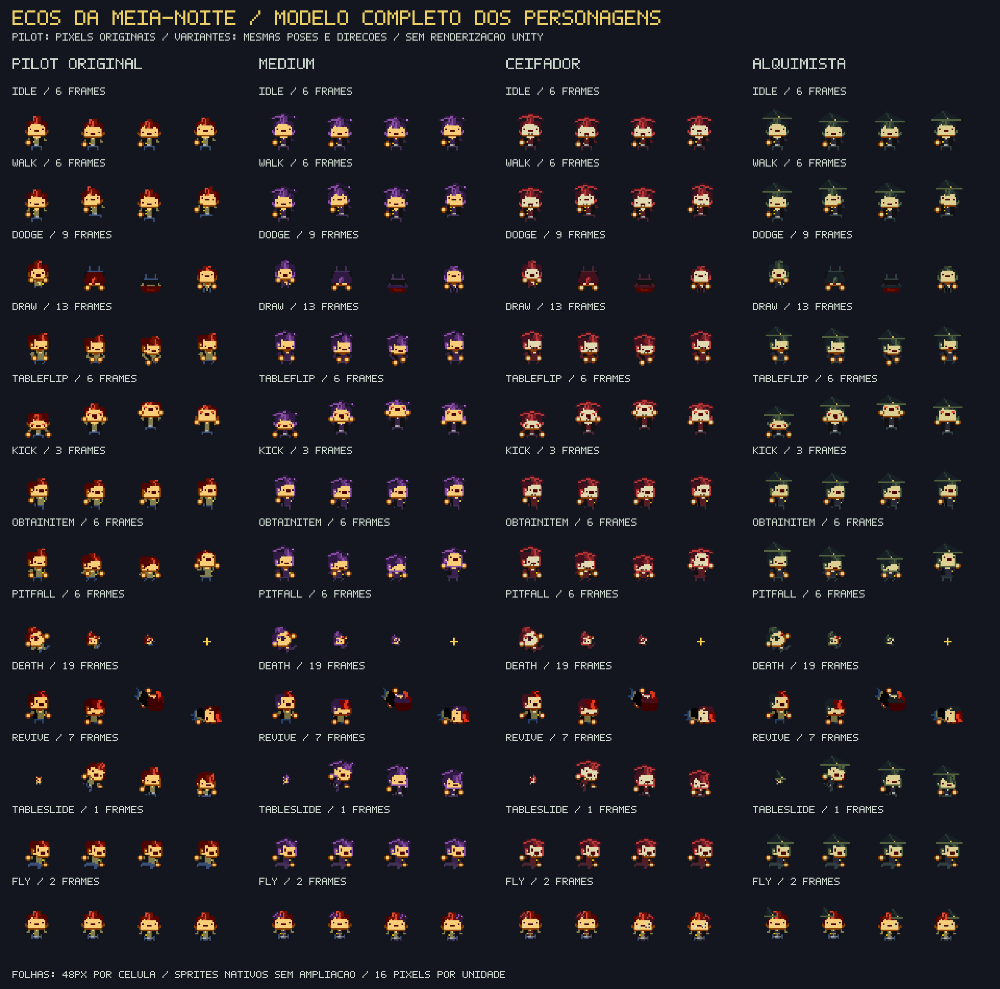

# Ecos da Meia-Noite

Roguelike de ação em pixel art para **Unity 6.0 LTS 6000.0.85f1**, com combate 2D, salas procedurais, quatro personagens, poderes, arsenal, chefes e Mercado das Almas. A arte combina a folha de personagem fornecida pelo usuário, suas variantes e desenhos procedurais. Efeitos sonoros e música são sintetizados localmente; o jogo não exige serviços externos.

[**Projeto no GitHub**](https://github.com/ManoelRIos/ecos-vale/tree/codex/ecos-do-vale-vertical-slice) · [**Baixar projeto em ZIP**](https://github.com/ManoelRIos/ecos-vale/raw/refs/heads/codex/ecos-do-vale-vertical-slice/Distribution/EcosDaMeiaNoite.zip)

## Abrir e jogar

1. Instale **Unity 6000.0.85f1** pelo Unity Hub; acrescente Windows Build Support para gerar um executável Windows.
2. Extraia todo o ZIP em uma **pasta nova e curta**, por exemplo `C:\Dev\EcosDaMeiaNoite`. Preserve suas alterações da cópia anterior. A raiz deve conter `Assets`, `Packages` e `ProjectSettings`.
3. No Hub, use **Add / Add project from disk** e selecione essa raiz. Abra o projeto, aguarde os pacotes e a compilação e use **Ecos → Abrir roguelike**, com Play parado, para abrir `Assets/_Game/Scenes/Haunt.unity`.
4. Pressione **Play**, escolha uma das quatro almas e inicie. Uma semente numérica repete a planta, os perfis de encontro, o chefe e as ofertas daquela versão; vazia gera outra incursão.

O atalho opcional `ABRIR_ECOS_DA_MEIA_NOITE.cmd` continua disponível para instalações no caminho padrão do Hub; `/check` confere a pasta e o log fica em `Logs/MeiaNoite-Editor.log`. Abrir pelo Hub dispensa o atalho. O atalho não foi executado no Windows neste ambiente.

Para atualizar por ZIP, use uma extração nova: sobrepor pastas não remove arquivos antigos. Um clone Git atualizado também aplica as remoções rastreadas. Ainda não há um executável Windows validado desta revisão.

## Personagens no modelo da folha original

O primeiro personagem aparece como **PILOTO** e usa os pixels da folha de *The Pilot*, de *Enter the Gungeon*, enviada pelo usuário. O PNG original permanece intacto em [PilotOriginal.png](Assets/_Game/ArtSources/PilotOriginal.png). O importador recorta as poses, conserva suas cores RGB e remove apenas as cores de fundo indicadas para cada recorte, sem ampliar ou redesenhar o personagem.

**Médium, Ceifador e Alquimista** são variantes desse mesmo modelo, com paletas e acessórios próprios. Compartilham a organização, as direções e as sequências de poses da fonte. O catálogo distingue poses sem arma, com uma mão e com duas mãos, além do traje alternativo. Cada animação usa sua quantidade de quadros e seu tempo; o jogador deixou de depender do limite de quatro poses dos protótipos anteriores.

Os personagens ativos ficam em [CharacterSheets](Assets/_Game/Resources/CharacterSheets), com filtro Point e **16 pixels por unidade**, preservando o desenho nativo. A célula interna de 48×48 inclui espaço transparente e não representa um redimensionamento da arte. A arma equipada continua em um renderer separado; tiros, recarga e poderes usam a pose original adequada e os efeitos do combate.



Veja [CHARACTER_MODEL.md](Documentation/CHARACTER_MODEL.md) para a fonte, o catálogo completo e a importação. As poses de mesa, baú, voo, fantasma e reviver estão disponíveis na biblioteca; sua presença na folha não adiciona essas mecânicas nem multiplayer ao jogo.

## Mobs, bosses, objetos e munição

Espantalho, Gárgula, Sombra, Morcego de Fogo, Esqueleto e Slime mantêm folhas de combate próprias. O Carrasco usa armadura azul e machado; o Mestre Abóbora tem capa roxa, foice e morcegos. Os demais cinco bosses mantêm o mesmo formato de animação.

As **24 folhas procedurais de referência, com 1.700 células**, continuam em [ReferenceSheets](Assets/_Game/Resources/ReferenceSheets): seis mobs em **48×48**, bosses em **96×96**, barris/baú em **32×32** e os protótipos de personagens usados como fallback. Elas trabalham em **32 pixels por unidade**. As 17 armas, relíquias e objetos de cenário também recebem detalhes procedurais de metal, madeira, empunhaduras, mecanismos e partes luminosas. Veja [SPRITESHEETS.md](Documentation/SPRITESHEETS.md) e a [prévia dos equipamentos](Documentation/EQUIPMENT_DETAIL.png).

**R recarrega a arma; no controle, Triângulo.** Cada arma mantém seu próprio carregador e reserva. A arma inicial de cada alma e o revólver têm reserva infinita, mas exigem recarga manual. Armas compradas têm reserva limitada e podem esgotar. Uma carga paga o disparo completo dos leques; feixes consomem por pulso de dano. A recarga bloqueia tiros, movimenta a arma e tem efeitos sonoros próprios. Trocar de arma cancela a recarga sem perder munição; pausa e conversas congelam seu tempo.

Após adquirir uma arma com reserva finita, inimigos têm **12% de chance** de deixar uma caixa de munição. Aproximar-se repõe uma quantidade equivalente a um carregador na reserva da arma equipada, ou de outra arma possuída que precise. Se todas estiverem cheias, a caixa fica no chão. Caixas não coletadas persistem nas revisitas ao mesmo andar. Veja os valores e padrões em [MUNICAO_E_TERROR.md](Documentation/MUNICAO_E_TERROR.md).

A [prévia das folhas procedurais](Documentation/REFERENCE_SPRITESHEETS.png) inclui os protótipos anteriores dos jogadores. Os personagens ativos aparecem na prévia do modelo original acima. As duas montagens usam os pixels dos arquivos, sem renderização no Unity.

## Salas irregulares e expansão de Halloween

As salas usam cinco formatos: **L, T, H, octógono e alcovas**, com recortes, contornos elevados e abismos internos. Quatro acessos cardinais e um núcleo seguro preservam as portas; os formatos L/T recebem corredores de acesso quando necessário. A sala H liga duas áreas pela passagem central. O minimapa agora mostra a silhueta real de cada sala. A colisão dos recortes é compartilhada por movimento, tiros e raios, e a navegação dos inimigos contorna paredes e cobertura.

**Barris explosivos** têm madeira abaulada, cintas, caveira e pavio com faíscas. A explosão anunciada causa dano, empurrão e trauma. **Barris de ácido** têm metal amassado, transbordamento e gotas verdes; deixam uma poça luminosa que causa dano em pulsos por oito segundos. **Pilares destrutíveis** recebem rachaduras antes de perder a colisão. Urnas de água continuam disponíveis. Lápides, grades e velas ossuárias decoram as bordas sem fechar passagens.

Os quatro heróis usam o catálogo de poses do modelo original e mantêm seus poderes e equipamentos. Quatro criaturas ampliam o catálogo para **17 mobs comuns**: Espantalho Amaldiçoado, Gárgula de Pedra, Sombra Perseguidora e Morcego de Fogo. A gárgula alterna 1,5 s de pedra imune e 1,5 s de voo; a sombra cruza paredes; o morcego deixa brasas e dispara quatro tiros ao morrer enquanto o combate continua.

Os sete bosses possuem **Idle, Telegraph, Attack, Enrage e Death**, com quatro poses em cada estado. A fúria aparece abaixo de 50% de vida e aumenta a mobilidade/cadência. Entrar em uma sala de chefe inicia uma **intro obrigatória de três segundos**, com pan de câmera, tarjas, título, subtítulo e provocação. É possível responder ao desafio dentro dessa janela com E ou 1/2; a resposta não encurta o tempo da apresentação.

O atendente oferece diálogo com retrato, letras graduais e voz procedural. E avança/completa o texto; 1/2 escolhem respostas; **NEGOCIAR** abre o catálogo. Há dicas e história além do comércio. Controle usa direcional e X, Círculo fecha. A trilha ambiente desaparece ao entrar no chefe; uma faixa exclusiva a **144 BPM** começa na intro e continua até a vitória, quando retorna o tema do andar.

A prévia a seguir é produzida pelos desenhos C# reais, **sem renderização no Editor Unity**. Veja [SALAS_E_HISTORIAS.md](Documentation/SALAS_E_HISTORIAS.md) para módulos e validação.

A prévia anterior permanece em [IRREGULAR_HALLOWEEN.png](Documentation/IRREGULAR_HALLOWEEN.png); os desenhos atuais estão acima.

## Câmera, impacto e evasão

A câmera antecipa a mira em **20%**, com limite de duas unidades, suavização e recuo oposto ao disparo. O screen shake usa **trauma e Perlin Noise**, com reações fortes a explosões e golpes de chefes. Acertos geram flash branco de **0,06 s**, deformação breve e recuo com colisão; chefes resistem mais ao empurrão. O cano recebe clarão luminoso e ejeta cápsulas que pousam e ficam no chão da sala, com limite de quantidade.

O rolamento concede proteção nos **primeiros 60%** e tem **40% de recuperação vulnerável**. As cópias espectrais usam a pose do personagem escolhido e desaparecem em **0,2 s**. O salto sobre abismos continua usando a duração completa da esquiva.

Os inimigos agora usam um **gerador modular de padrões**: cones, anéis que desaceleram, mira preditiva, projéteis guiados limitados, ondas intercaladas e ataques de morte. Chefes têm espirais, bombas em cruz, teias de lentidão, cruzes que viajam em formação, ondas com brecha rotativa, leques de 180° e orbes que se dividem em 12 tiros. As emissões são anunciadas antes de ocorrerem. Veja o catálogo e os módulos em [GAME_FEEL.md](Documentation/GAME_FEEL.md).

## Combate com mais variedade

Cada sala de combate mantém **três ondas**, mas recebe um perfil próprio: **enxame**, **emboscada**, **fogo cruzado** ou **elite**. Formações e combinações variam, os inimigos são mais ativos e a vida cresce de modo mais moderado. As criaturas emergem de fendas durante 0,9 s; nesse preparo não atacam nem recebem dano. A recompensa e as saídas são liberadas após a última onda. Minibosses aparecem junto aos grupos em salas determinadas pela semente.

Há dezessete criaturas comuns, além do miniboss e dos chefes. O catálogo também preserva **Lanterna Errante**, que orbita e atira; **Cogumelo Bruto**, que pressiona com avanços e ataques marcados; e **Diabrete de Corda**, que alterna movimento e rajadas. A separação entre criaturas reduz os amontoados. O runtime limita os tiros hostis a 140 e reserva capacidade para os disparos do jogador.

As salas têm **barris explosivos** e **urnas de água** atingíveis por tiros de ambos os lados e por raios. Barris anunciam a explosão por 0,55 s, ferem criaturas e jogador e podem provocar reações em cadeia; cobertura bloqueia a explosão. Urnas deixam poças por até 14 s, reduzindo a velocidade de quem anda sobre elas a 60%; esquivar permite atravessar sem essa redução. Objetos quebrados permanecem quebrados ao revisitar a sala durante a incursão.

Andares começam com 7 salas, recebem duas a cada avanço e chegam ao limite de 27. O limite das arenas é 29 × 17 unidades, com área ocupada variando por formato, com câmera próxima que acompanha o personagem. Algumas salas têm abismos atravessáveis por esquiva/salto; cair custa uma vida e retorna ao último chão seguro. Uma seta aponta à saída mais próxima após a purificação e prioriza o portal após o chefe.

## Pixel art, projéteis e profundidade

Os tiros agora têm **corpo maior, contorno contrastante e núcleo claro**, com cápsulas, pétalas, ossos, discos e energia de formas distintas. Um halo curto acompanha todo projétil na mesma altura, acompanhado de clarão e rastro colorido; balas hostis também deixam um rastro curto. Os disparos hostis preservam borda rosa/vermelha. A relíquia de tamanho também aumenta o raio de colisão, mantendo a melhoria funcional.

A apresentação reforça o aspecto **2.5D por camadas**: paredes têm faces elevadas e coroamentos, os objetos projetam sombras, atores e cobertura são ordenados pela posição dos pés e as paredes próximas ficam translúcidas quando cobririam o personagem. A posição elevada dos sprites não altera a colisão no chão. A câmera e a simulação continuam no plano 2D; esta revisão não converte o cenário para malhas 3D. Há neblina baixa animada em temas e salas específicos, sem passar sobre os projéteis.

Os cinco temas mantêm pisos e paredes próprios: Jardins da Colheita, Galeria dos Véus, Catedral das Cinzas, Ninho da Peste e Abismo dos Sinos. A atmosfera usa azul noturno e roxo profundo, com vinheta escura de centro transparente. Velas, candelabros, abóboras e lanternas têm luz quente com intensidade e raio modulados por Perlin Noise; cristais, magia e poças recebem luz verde/roxa. Sombras ovais e neblina baixa em movimento reforçam a profundidade. A interface usa letras bitmap 5 × 7; o HUD mantém corações e textos sem tarjas.

A prévia abaixo mostra os pixels gerados pelos métodos C# com tipos auxiliares fora do Editor. **Não é captura da renderização Unity.**

[Prévia anterior do arsenal e dos encontros](Documentation/ARSENAL_AND_ENCOUNTERS.png).

## Personagens, arsenal e relíquias

| Alma | Arma inicial | Poder |
| --- | --- | --- |
| Piloto | Carabina da Aurora, cápsula turquesa | Limpa tiros próximos e concede proteção breve |
| Médium do Véu | Varinha do Véu, pétalas em leque | Rajada espectral ampla |
| Ceifador Errante | Ceifador de Ossos, dano duplo | Disparo radial e proteção breve |
| Alquimista de Cinzas | Bobina Voltaica, raio contínuo | Recupera vida |

A loja sorteia **uma ou duas armas por andar**, entre as ainda não adquiridas. A seleção fica estável durante a visita, inclusive depois de comprar; cada produto aparece em uma vitrine. O catálogo também vende cura, dano, cadência, vida máxima e três relíquias:

- **Balas Gigantes:** +30 pontos percentuais de tamanho por compra, até 160%, com aumento correspondente da colisão.
- **Botas Ligeiras:** +12,5 pontos percentuais de velocidade por compra, até 125%.
- **Relíquia da alma:** Olho da Aurora ou Dente Lunar concedem +1 de dano aos tiros; Fita do Véu reduz a recarga do poder em 30%; Coração Voltaico aumenta a cura para 3 e reduz sua recarga em 15%.

As três novas armas são o **Guarda-Chuva**, com cinco pétalas e dois ricochetes; a **Colmeia de Bolso**, com três ferrões de perseguição suave; e a **Luva de Boxe**, com tiro pesado que empurra criaturas sem atravessar obstáculos. O catálogo inclui ainda Grampeador, Banana, Pião do Caos, Disco Espelho, Lanterna de Raios, Flauta de Ossos, Bacamarte, Repetidora e Canhão das Almas. Armas têm cadências e padrões próprios; cobertura e paredes bloqueiam projéteis e raios.

Caminhe até o atendente e use E/X ou clique nele a até 2,8 unidades para conversar; escolha NEGOCIAR para abrir o catálogo. Apenas a conversa bloqueia o movimento. Itens usam ícones, preço e uma característica curta, com três cartões por página. Feche a conversa e caminhe até o portal para descer. Compras recusadas não consomem almas; equipamentos e melhorias duram até o fim da incursão.

## Sete chefes

Todos têm animação, ataques anunciados e barra de vida em pixel art na parte inferior. **Carrasco de Ferro** e **Oráculo do Brejo** juntam-se aos cinco guardiões anteriores, com três padrões próprios e mudança de intensidade quando feridos. O tema sorteia um destes três candidatos a cada andar:

| Tema | Candidatos |
| --- | --- |
| Jardins da Colheita | Rei das Abóboras, Viúva do Véu, Carrasco de Ferro |
| Galeria dos Véus | Viúva do Véu, Bispo das Cinzas, Oráculo do Brejo |
| Catedral das Cinzas | Bispo das Cinzas, Sino do Abismo, Carrasco de Ferro |
| Ninho da Peste | Matriarca da Peste, Oráculo do Brejo, Rei das Abóboras |
| Abismo dos Sinos | Sino do Abismo, Carrasco de Ferro, Oráculo do Brejo |

## Teclado, mouse e controle

O suporte inicial usa o **Unity Input System**. Um **DualShock 4 de PS4** reconhecido pelo sistema pode ser usado por USB ou Bluetooth; o funcionamento no hardware/driver específico ainda precisa ser testado. Mira mantém a última direção do analógico direito. Menus, seleção de personagem, loja, pausa e reinício podem ser operados sem mouse.

| Ação | Teclado / mouse | Controle PS4 |
| --- | --- | --- |
| Mover | WASD / setas | Analógico esquerdo |
| Mirar | Mouse | Analógico direito |
| Atirar | Botão esquerdo | R2 |
| Recarregar | R | Triângulo, fora do catálogo |
| Esquivar / saltar | Espaço / botão direito | Círculo / L2 |
| Usar poder | Q | Quadrado |
| Conversar / usar portal | E | X |
| Trocar arma | Tab / roda do mouse; 1–0 para atalhos | L1 / R1 |
| Mapa | M | Share / clique no touchpad |
| Pausar | Esc | Options |
| Navegar e confirmar menu | Mouse | Direcional / analógico esquerdo e X |
| Fechar conversa | Esc / Fechar | Círculo |
| Abas / páginas da loja | Botões do catálogo | L1/R1 e Triângulo |

Atalhos: 1 arma inicial; 2 Grampeador; 3 Banana; 4 Pião; 5 Disco; 6 Lanterna; 7 Flauta; 8 Guarda-Chuva; 9 Colmeia; 0 Luva. Tab, roda e L1/R1 alcançam todo o inventário. O mesmo X que abre uma tela não compra um item.

M abre um atlas de 1060 × 580 na referência 1280 × 720, com desenhos a 95% e fundo escuro a 78%. O minimapa mantém 45% de opacidade. Ambos são passivos: o combate continua.

## Música e efeitos

Cinco trilhas ambientes e uma faixa exclusiva de chefe, todas sintetizadas e originais, usam melodia, harmonia, baixo e percussão. O mercado recebe uma camada calma; o combate e os chefes aumentam a intensidade, com transições suaves. Disparos, impactos, recargas, gatilho vazio, coleta de munição, poderes, explosões, água, compras e mortes têm efeitos curtos. O áudio tem limite de vozes, pausa com o jogo, respeita perda de foco e pode ser desligado em **SOM** no menu de pausa. Não são necessários arquivos de áudio externos.

## Desenvolvimento e limites da validação

```bash
python3 -m pip install -r Tools/requirements-validation.txt
python3 Tools/validate_project.py
python3 -m unittest discover -s Tools -p 'test_*.py'
dotnet run --project Tools/HauntChecks.csproj
```

Passaram **30 testes Python** e **2.506.552 asserções do núcleo real C#**, incluindo 2.436 andares. A sintaxe e os metadados também foram conferidos. Helpers temporários com tipos Unity simulados verificaram contratos entre os parciais e lógica de combate, objetos, controle, arte e áudio; não são uma execução no motor.

**O Editor Unity não está instalado neste ambiente.** Importação, compilação no Unity, aparência renderizada, reprodução sonora, build e controle PS4 físico ainda precisam ser validados no Editor/PC. O jogo continua solo e sem save entre sessões. Consulte [VALIDATION.md](Documentation/VALIDATION.md), [ARCHITECTURE.md](Documentation/ARCHITECTURE.md) e [UNITY_TROUBLESHOOTING.md](Documentation/UNITY_TROUBLESHOOTING.md).

Com Editor licenciado, execute o Test Runner ou `bash Tools/unity-check.sh import`, `smoke`, `tests` e `build`, com `UNITY_EDITOR_PATH` definido. O build usa `Builds/Windows/EcosDaMeiaNoite.exe`. Para gerar o ZIP das fontes, inclua arquivos novos no índice Git e execute `python3 Tools/package_project.py`; o pacote tem raiz `EcosDaMeiaNoite/` e não inclui builds ou caches.
